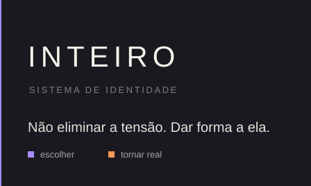

# INTEIRO

Sistema de identidade pessoal. Tokens, CSS, linha de comando e um contrato para que pessoas e agentes implementem a mesma decisão visual.

> Inteiro não é não ter partes em conflito. É conseguir fazê-las pertencer ao mesmo sistema.

**Não eliminar a tensão. Dar forma a ela.**

Este repositório transforma o documento de identidade em infraestrutura instalável: catálogo DTCG 2025.10, CSS, CLI, API para agentes, servidor MCP, adaptadores de harness, demonstração e testes. A versão do catálogo é `1.0.0`. A instalação é local, pelo monorepo ou por tarball.

A estrutura pesa mais que a expressão. A interface deve ficar mais interessante com o tempo, não mais impressionante em cinco segundos.

## Sinais

| Sinal | Papel |
|---|---|
| Violeta | Estou escolhendo. Um primary por contexto. |
| Laranja | Estou tornando real. Publicar, deploy, aplicar. |
| Recursive | A mesma voz, do racional ao humano. |
| Costura | Duas verdades no mesmo sistema. `border-inline-start` de 2px. |
| Calm / Focus | Respirar ou operar, sem trocar de pessoa. |

Atmosfera: neutro quente sobre dark. Obsidian e Warm Frost. O preto absoluto fica de fora.

## Cinco leis

1. **A estrutura é silenciosa.** Grade, alinhamento e escala não chamam atenção para si.
2. **A personalidade aparece na decisão.** Violeta e laranja marcam escolha e compromisso. O resto permanece neutro.
3. **Densidade é permitida. Desordem, não.** `focus` aproxima a informação. Não esconde dado para a tela parecer calma.
4. **A assimetria comunica tensão.** A Costura entra em reflexão, conflito, mudança de interpretação ou troca de contexto. Em RTL ela continua no início lógico.
5. **O sistema não performa inteligência.** O texto diz o que aconteceu, por quê se souber, e o que fazer.

## Começar

Node `>= 22.14`.

### Neste repositório

```bash
npm install
npm run build
npm test
npm run demo
```

A demonstração abre em `http://127.0.0.1:4173/`. Temas light e dark, densidades calm e focus, botões, formulário, dashboard, Costura, tipografia e estados.

### Num projeto

Os quatro tarballs entram no mesmo `npm install`. A dependência cruzada é `1.0.0`.

```bash
mkdir -p artifacts
npm pack -w @inteiro/tokens --pack-destination artifacts
npm pack -w @inteiro/agent-core --pack-destination artifacts
npm pack -w @inteiro/cli --pack-destination artifacts
npm pack -w @inteiro/design-system --pack-destination artifacts
```

```bash
npm install \
  ../IDS/artifacts/inteiro-tokens-1.0.0.tgz \
  ../IDS/artifacts/inteiro-agent-core-1.0.0.tgz \
  ../IDS/artifacts/inteiro-cli-1.0.0.tgz \
  ../IDS/artifacts/inteiro-design-system-1.0.0.tgz

npx inteiro init --yes
npx inteiro doctor
npx inteiro tokens explain color.identity.primary
```

`init` detecta Next, React, Vue, Svelte ou HTML, grava `inteiro.css` e anexa um bloco em `AGENTS.md` entre `<!-- inteiro:start -->` e `<!-- inteiro:end -->`. O restante do arquivo permanece.

Para um agente instalar o harness a partir deste monorepo, o contrato está em [docs/QUICKSTART.md](docs/QUICKSTART.md).

### Primeira interface

```css
@import "@inteiro/tokens/css";
@import "@inteiro/design-system/css/components";
```

```html
<html data-in-theme="dark" data-in-density="focus">
  <button class="in-button in-button--primary">Salvar rascunho</button>
  <button class="in-button in-button--commit">Publicar</button>
</html>
```

Texto por `color.text.*`. Um primary por contexto. Commit só quando a ação sai para o mundo.

Exemplos em [`examples/html`](examples/html), [`examples/react`](examples/react), [`examples/vue`](examples/vue), [`examples/svelte`](examples/svelte), [`examples/nextjs`](examples/nextjs), [`examples/tailwind`](examples/tailwind) e [`examples/flutter`](examples/flutter).

## Pacotes

| Pacote | Função |
|---|---|
| `@inteiro/tokens` | 316 tokens DTCG. CSS, JSON, TypeScript, SCSS, Flutter, Swift, Tailwind. |
| `@inteiro/design-system` | CSS das recipes e o binário `inteiro`. |
| `@inteiro/cli` | `init`, `doctor`, `tokens`, `themes`, `skills`, `agents`, `audit`, `migrate`. |
| `@inteiro/agent-core` | Explicação, busca, recipes, guidelines e auditoria. |
| `@inteiro/mcp` | Servidor MCP em stdio. |
| `@inteiro/react` | Provider. O tema chega por variáveis CSS. |
| `@inteiro/skills` | Geração de `SKILL.md`. |
| `@inteiro/adapter-*` | Codex, Claude, Devin, Cursor, Pi, Hermes. |
| `@inteiro/integrations` | Tailwind, Vue, Svelte. |

O produto declarável é um contrato: tokens, CSS e recipes. Classes publicadas: botão, campo, card, badge e vozes. Dialog, tabela, navegação, empty state e loading são recipes, com passos e sem classe própria.

Camadas do catálogo: 134 primitivos, 154 semânticos, 28 de componente. Prefixo CSS: `--in-`.

## Linha de comando

```bash
npx inteiro tokens search commit
npx inteiro tokens explain color.identity.commit
npx inteiro tokens export --format css --out ./inteiro.css
npx inteiro themes inspect dark
npx inteiro agents install cursor --yes
npx inteiro agents doctor
npx inteiro audit .
```

Códigos de saída: `0` ok, `2` uso, `3` não encontrado, `4` inválido, `5` IO.

`--dry-run` não escreve. `--yes` permite substituir um arquivo que já difere. Em CI, os dois juntos com `--json`.

A referência completa está em [docs/CLI.md](docs/CLI.md).

## Agentes

O núcleo é comum. Cada harness recebe o mecanismo que a ferramenta realmente documenta.

| Harness | O que a instalação grava |
|---|---|
| Codex | `.agents/skills`, `plugin.json`, `.codex-plugin`, `mcp.json` |
| Claude Code | `.claude/skills`, `.claude-plugin`, `.mcp.json` |
| Devin | `.agents/skills`, playbook e knowledge em markdown |
| Cursor | `.cursor/rules`, skills, `.cursor-plugin`, MCP |
| Pi | `.pi/skills`, `.agents/skills` |
| Hermes | `.agents/skills`, `HERMES.md`, plugin |

```bash
npx inteiro agents install cursor --yes
npx inteiro agents doctor
```

São dez skills de entrada: `inteiro`, `inteiro-interface`, `inteiro-audit`, `inteiro-migrate`, `inteiro-choose-token`, `inteiro-identity`, `inteiro-a11y`, `inteiro-voice`, `inteiro-components`, `inteiro-validate`. A consulta fina de um token fica na CLI ou no MCP.

## Documentação

Tudo em português brasileiro. Identificadores de API em inglês.

**Usar** — [Começar](docs/GETTING_STARTED.md) · [CLI](docs/CLI.md) · [Quick-start para agentes](docs/QUICKSTART.md) · [Temas](docs/THEMING.md) · [Integrações](docs/INTEGRATIONS.md) · [Componentes](docs/COMPONENTS.md)

**Decidir** — [Marca](docs/BRAND.md) · [Voz](docs/VOICE_AND_TONE.md) · [Tokens](docs/TOKENS.md) · [Acessibilidade](docs/ACCESSIBILITY.md) · [Arquitetura](docs/ARCHITECTURE.md)

**Manter** — [Agentes](docs/AGENTS.md) · [Skills](docs/SKILLS.md) · [Publicação](docs/PUBLISHING.md) · [Validação](docs/VALIDATION_REPORT.md) · [Rastreabilidade](docs/SOURCE_TRACEABILITY.md) · [Contribuir](CONTRIBUTING.md)

A documentação visual vive em `apps/demo` e sobe com `npm run demo`.

## Como uma decisão vira interface

```
decisões de identidade
        ↓
  primitives          matéria
        ↓
  semantic            significado · dark / light
        ↓
  component           contrato · calm / focus
        ↓
  CSS · TypeScript · Flutter · skills · agentes
```

A dependência segue um sentido. Componente não aponta para hex nem para primitivo de cor. A fonte de identidade é `deep-research-report.md`. A fonte de tokens é `packages/tokens/src/catalog`. Arquivos em `dist/` são gerados.

Mudar o significado de `primary` — de violeta para laranja, por exemplo — é uma versão maior, mesmo que o TypeScript continue compilando.

## Repositório

- `main` recebe somente `release` e `hotfix`.
- `develop` integra. Features saem daqui e voltam para cá.
- `release/*` entra em `main` e em `develop`.
- `hotfix/*` sai de `main` e volta para `main` e `develop`.

Licença [MIT](LICENSE).

Não criar um token porque existe uma propriedade CSS. Criar um token porque existe uma decisão que merece ser lembrada.
