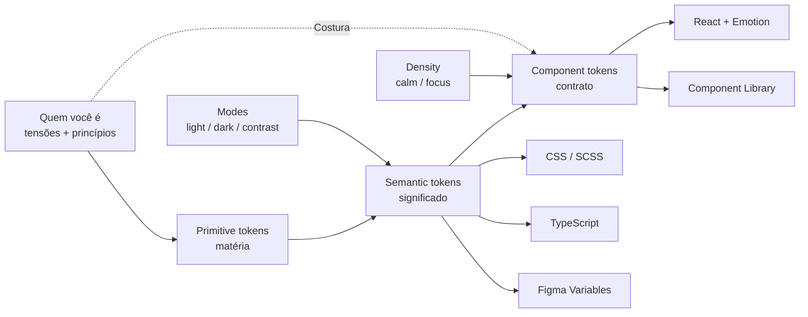
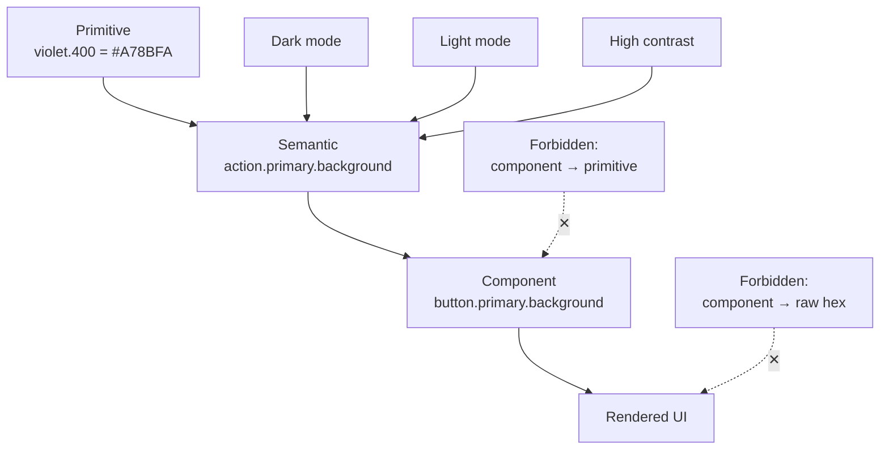
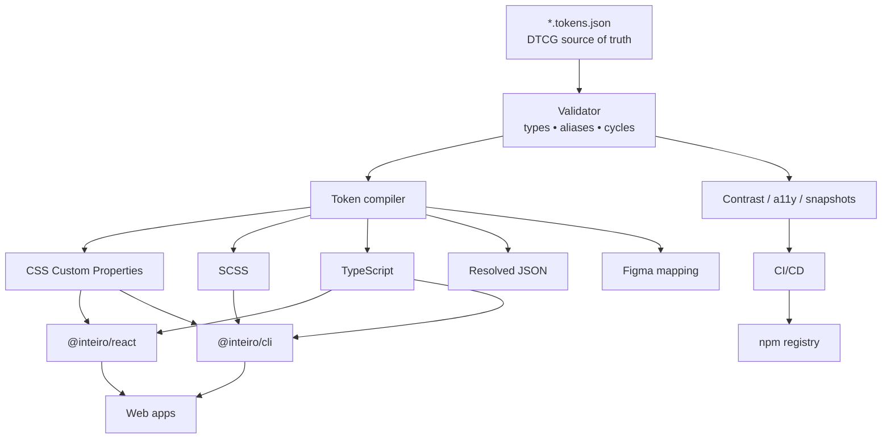
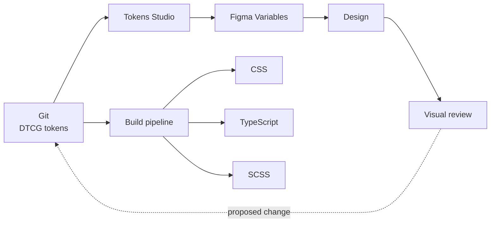

# INTEIRO — Identity Design System pessoal, completo e production-ready

## Resumo executivo

**INTEIRO** não deveria ser apenas um design system “bonito com a sua paleta”. Ele deveria funcionar como uma **representação operacional da sua maneira de pensar**: alguém que busca estrutura sem querer ser reduzido à estrutura; que gosta de precisão, mas rejeita o genérico; que percebe valor em sistemas, mas quer que o sistema preserve autoria; e que não parece querer apagar contradições internas, e sim encontrar uma forma coerente de carregá-las.

Há uma limitação importante nesta leitura: **a pasta/projeto pessoal a que você se referiu não ficou acessível como fonte recuperável neste contexto**. Não vou fingir que li materiais que não consegui ler. Portanto, a camada psicológica abaixo não é um “diagnóstico” seu: ela é uma **hipótese identitária construída a partir da forma como você formula problemas, corrige abstrações que parecem genéricas e do que você explicitamente pediu neste diálogo**. Isso significa que considero muito confiáveis traços como busca por precisão, autoria, coerência, profundidade e aversão a soluções genéricas; os “conflitos” são tratados como eixos de projeto a serem materializados, não como afirmações clínicas sobre você.

A tese central do sistema seria:

> **Inteiro não é não ter partes em conflito. É conseguir fazê-las pertencer ao mesmo sistema.**

Isso muda tudo em relação ao conceito anterior.

O primeiro DS tentava descrever você como “engenheiro sofisticado”. **INTEIRO parte de outra premissa: você não é uma estética. É uma tensão organizada.**

| Eixo identitário | Manifestação no IDS |
|---|---|
| **Razão ↔ expressão** | A mesma família tipográfica vai do racional ao humano, em vez de usar duas personalidades desconectadas |
| **Controle ↔ impulso** | Violeta representa ação deliberada; laranja representa o momento de atravessar o limite e fazer algo acontecer |
| **Complexidade ↔ clareza** | A interface aceita densidade, mas revela hierarquia rigorosamente |
| **Sistema ↔ autoria** | Tokens extremamente sistemáticos, porém com gestos visuais que não parecem “SaaS template” |
| **Interior ↔ exterior** | Modo `calm` para reflexão e modo `focus` para operação, usando a mesma identidade |
| **Fragmento ↔ inteiro** | Um elemento gráfico chamado **Seam / Costura** aparece onde duas partes precisam coexistir |
| **Precisão ↔ humanidade** | Neutros não são frios; o branco é levemente quente e o preto nunca é preto absoluto |

A paleta continua essencialmente na direção que você aprovou, mas ganha uma semântica muito mais específica: **violeta não é “cor de tecnologia”; é consciência deliberada. Laranja não é “accent”; é decisão. Mint não é decoração; é resolução. Vermelho é ruptura. O off-white introduz humanidade numa estrutura predominantemente escura.**

A tipografia é onde eu faria a mudança mais autoral. Em vez de Inter + JetBrains Mono, INTEIRO adotaria **Recursive** como voz tipográfica central. Ela é uma variable font desenhada especificamente para UI e código e possui dois eixos particularmente adequados à identidade: `MONO`, que transita entre sans proporcional e monoespaçada, e `CASL`, que transita entre formas lineares/racionais e formas mais casuais/expressivas. Assim, **o lado racional e o lado expressivo deixam de ser fontes diferentes e viram estados da mesma fonte**. É praticamente a metáfora tipográfica de INTEIRO. A família é licenciada sob SIL Open Font License 1.1. citeturn18view0turn19view2

Tecnicamente, a fonte de verdade deve ser um conjunto de arquivos **DTCG Design Tokens Format 2025.10**, distribuído como JSON, compilado para CSS Custom Properties, SCSS, TypeScript e JSON resolvido. A especificação DTCG define JSON como formato de intercâmbio, recomenda extensões `.tokens` ou `.tokens.json`, possui aliases, grupos, tipos, tokens compostos e depreciação. A versão 2025.10 é a base estável que eu escolheria para produção; é um Final Community Group Report do W3C Design Tokens Community Group, não uma W3C Recommendation. citeturn15view2turn15view3

A arquitetura proposta é:



A distribuição ideal é um pequeno monorepo com `@inteiro/tokens`, `@inteiro/react` e `@inteiro/cli`, sendo o CLI executável por `npx`. O npm atual permite que `npx` execute diretamente o `bin` declarado por um pacote, inclusive baixando-o quando necessário. citeturn16view1

A meta não é produzir “outro design system dark com roxo”. É fazer com que, ao esconder o nome INTEIRO, **a interface ainda seja reconhecível como sua**.

## Identidade, linguagem visual e personalidade codificada

O princípio visual mais importante é:

**INTEIRO não tenta resolver tensão eliminando um dos lados. Ele cria estrutura suficiente para que os dois existam.**

Isso gera cinco leis.

**A estrutura deve ser silenciosa.** Grid, alinhamentos, tokens, ritmos e hierarquia são rigorosos, mas não devem chamar atenção para si.

**A personalidade deve aparecer em pontos de decisão.** Não em gradients decorativos, glow, glassmorphism ou vinte microinterações.

**Densidade é permitida; desordem não.** Um dashboard pode carregar muita informação. A solução não é esconder dados arbitrariamente, mas construir prioridade perceptiva.

**A assimetria só existe quando comunica tensão.** O layout-base é estável. A assinatura visual aparece como um corte, costura, deslocamento tipográfico ou contraste contextual.

**O sistema nunca deve performar inteligência.** Sem frases rebuscadas apenas para parecer profundo; sem terminal fake; sem hexadecimal como decoração; sem jargão técnico onde uma palavra simples serve.

A assinatura gráfica de INTEIRO é a **Costura**.

```text
                    ┌──────────────────────────────────┐
                    │                                  │
         COSTURA →  │  Uma ideia pode conter          │
                    │  duas coisas verdadeiras         │
                    │  ao mesmo tempo.                 │
                    │                                  │
                    └──────────────────────────────────┘
                    ↑
               2px identity
```

Na implementação, ela não é necessariamente uma borda à esquerda. É `border-inline-start`, de forma que a identidade sobreviva a interfaces RTL. CSS Logical Properties existe precisamente para definir margens, padding, bordas e alinhamentos relativos ao fluxo da escrita; em idiomas RTL, `inline-start` muda de lado automaticamente. citeturn15view1turn14view0

```css
.in-seam {
  border-inline-start: 2px solid var(--in-color-identity-primary);
  padding-inline-start: var(--in-space-400);
}
```

A Costura é usada em apenas quatro situações: reflexão editorial, informação que muda interpretação, conflito/contraste entre alternativas e transição de contexto. **Nunca como decoração em todo card.**

A segunda assinatura é tipográfica.

Recursive permite um continuum entre proporcional e mono através de `MONO`, e entre Linear e Casual através de `CASL`. O projeto da fonte recomenda a variante proporcional para texto/interface e a monoespaçada para código, identificadores e dados; `CASL` permite aumentar expressão sem trocar de família. citeturn19view2

Isso vira quatro vozes:

| Voz | `MONO` | `CASL` | Uso | Significado |
|---|---:|---:|---|---|
| `rational` | 0 | 0 | Interface, navegação, controles | Pensamento estruturado |
| `human` | 0 | 0.35 | Editorial, abertura, reflexão | Interioridade |
| `signal` | 0 | 0.10 | Headlines e decisões | Convicção |
| `machine` | 1 | 0 | Código, IDs, métricas, timestamps | Precisão |

Exemplo:

```css
:root {
  --in-font-family:
    "Recursive",
    ui-sans-serif,
    system-ui,
    -apple-system,
    "Segoe UI",
    sans-serif;

  --in-font-machine:
    "Recursive",
    "SFMono-Regular",
    Consolas,
    "Liberation Mono",
    monospace;
}

.in-voice-rational {
  font-family: var(--in-font-family);
  font-variation-settings: "MONO" 0, "CASL" 0;
}

.in-voice-human {
  font-family: var(--in-font-family);
  font-variation-settings: "MONO" 0, "CASL" 0.35;
}

.in-voice-machine {
  font-family: var(--in-font-machine);
  font-variation-settings: "MONO" 1, "CASL" 0;
}
```

A fonte tem suporte extenso a línguas baseadas no alfabeto latino, inclusive português, mas não deve ser tratada como solução tipográfica universal para todos os scripts. Para árabe, CJK e outros scripts, o stack do IDS deve permitir fallback nativo configurável por locale. citeturn18view0

**A personalidade cromática** ficaria assim:

| Cor | Hex de referência | Papel psicológico | Regra |
|---|---|---|---|
| **Obsidian** | `#0C0D12` | Interior, silêncio | Canvas dark |
| **Warm Frost** | `#F4F1EA` | Humano, imperfeito | Texto principal dark |
| **Violet** | `#A78BFA` | Consciência, intenção | Seleção, identidade, foco |
| **Orange** | `#FF9A56` | Atravessar o limite | Commit, deploy, publicar |
| **Mint** | `#4FD1B5` | Resolução | Sucesso real |
| **Amber** | `#F2C66D` | Atenção | Warning |
| **Rupture** | `#FF6B7A` | Quebra, risco | Error/danger |
| **Blue** | `#72A7FF` | Informação externa | Info |

O laranja é particularmente importante. Num sistema genérico ele seria “secondary accent”. Em INTEIRO ele tem uma função muito mais estreita:

> **Violeta = estou escolhendo.  
> Laranja = estou tornando real.**

Por isso:

```text
Selecionar projeto       → violet
Alterar configuração     → violet
Abrir                    → neutral / violet

Deploy                    → orange
Publicar                  → orange
Aplicar mudança externa   → orange

Excluir                   → red
Falha                     → red
Aviso                     → amber
```

Isso impede o erro comum de transformar a cor mais expressiva da marca em decoração abundante.

**O modo de voz** também pertence ao IDS.

INTEIRO fala de maneira:

| É | Não é |
|---|---|
| Direto | Seco |
| Preciso | Pedante |
| Reflexivo | Místico |
| Técnico quando necessário | Jargon-heavy |
| Honesto sobre incerteza | Indeciso |
| Convicto sobre decisões | Arrogante |
| Humano | “Quirky startup” |

Microcopy preferida:

```text
Ruim:
Oops! Algo deu errado 😅

INTEIRO:
Não foi possível salvar.
A conexão foi interrompida antes da confirmação.
Tentar novamente
```

```text
Ruim:
Are you sure?

INTEIRO:
Excluir “projeto-x”?
Essa ação remove também os três ambientes vinculados.
[Cancelar] [Excluir projeto]
```

```text
Ruim:
Success! 🎉

INTEIRO:
Deploy concluído
production · 2f41c9a · agora
```

A marca nunca precisa gritar para provar que tem personalidade.

A frase-manifesto do sistema seria:

> **INTEIRO — não eliminar a tensão. Dar forma a ela.**

## Arquitetura e especificação completa de tokens

A fonte canônica deve seguir **DTCG 2025.10**. O formato define `$value`, `$type`, `$description`, grupos, aliases, extensões e `$deprecated`; tipos precisam ser inequívocos e ferramentas não devem inferi-los arbitrariamente a partir do conteúdo. citeturn15view3turn20view1

Há uma sutileza importante na nomenclatura: o DTCG proíbe `.` dentro **do nome individual** de um token ou grupo porque ponto é usado na sintaxe de aliases. Portanto, `color.background.canvas` é uma representação de caminho/documentação; no JSON real são grupos aninhados `color → background → canvas`. citeturn20view0

A arquitetura terá três camadas:

| Camada | Exemplo | Consumidor pode usar? | Muda frequentemente? |
|---|---|---:|---:|
| **Primitive** | `color.violet.400` | Não em componentes | Baixa |
| **Semantic** | `color.action.primary.background` | Sim | Média |
| **Component** | `button.primary.background` | Internamente | Alta |

A dependência é sempre unidirecional:



**Nomenclatura canônica**

```text
<domain>/<role>/<variant>/<state>/<property>
```

Em documentação:

```text
color/action/primary/default/background
color/action/primary/hover/background
form/input/focus/border
space/component/card/padding
motion/interaction/enter
```

No DTCG:

```json
{
  "color": {
    "action": {
      "primary": {
        "default": {
          "background": {}
        }
      }
    }
  }
}
```

Em TypeScript:

```ts
tokens.color.action.primary.default.background
```

Em CSS:

```css
--in-color-action-primary-default-background
```

Em SCSS:

```scss
$in-color-action-primary-default-background
```

O prefixo público é sempre `in`, curto o suficiente para CSS e inequivocamente associado a INTEIRO.

**Primitivos cromáticos**

| Família | 050 | 100 | 200 | 300 | 400 | 500 |
|---|---|---|---|---|---|---|
| Neutral | `#FAF8F4` | `#F4F1EA` | `#E7E2DA` | `#D0C9C2` | `#AAA3A6` | `#827C86` |
| Violet | `#F7F4FF` | `#EDE7FF` | `#DDD2FF` | `#C5B4FF` | `#A78BFA` | `#8B6CF2` |
| Orange | `#FFF5EC` | `#FFE7D4` | `#FFCDAA` | `#FFB27F` | `#FF9A56` | `#F47E2C` |
| Mint | `#EDFFF9` | `#CDF9EC` | `#9DECD7` | `#6EDFC4` | `#4FD1B5` | `#2BB99D` |
| Red | `#FFF0F2` | `#FFD9DF` | `#FFB4BF` | `#FF8C9A` | `#FF6B7A` | `#EB4D61` |
| Amber | `#FFF8E8` | `#FDECC0` | `#F8D98E` | `#F2C66D` | `#E6B44A` | `#CE9627` |
| Blue | `#EFF6FF` | `#DCEAFF` | `#B8D5FF` | `#92BBFF` | `#72A7FF` | `#4E8BED` |

| Família | 600 | 700 | 800 | 900 | 950 |
|---|---|---|---|---|---|
| Neutral | `#625D68` | `#45414C` | `#2C2A33` | `#1A1920` | `#0C0D12` |
| Violet | `#704EE0` | `#593BC2` | `#452F99` | `#352472` | `#21184A` |
| Orange | `#D96212` | `#B54A05` | `#8E3904` | `#692B08` | `#3D1806` |
| Mint | `#198E79` | `#126C5C` | `#105246` | `#0C3A32` | `#08251F` |
| Red | `#C9364C` | `#A1293C` | `#7D2331` | `#5C1D27` | `#370F16` |
| Amber | `#A97312` | `#83570D` | `#63410D` | `#462F0D` | `#2B1D07` |
| Blue | `#326BCB` | `#2853A0` | `#23417C` | `#1D315A` | `#101D36` |

Esses primitivos **não aparecem diretamente no código de componentes**.

**Semântica de cores**

| Token semântico | Dark | Light |
|---|---|---|
| `background.canvas` | `#0C0D12` | `#F7F5F1` |
| `background.surface` | `#13151D` | `#FFFFFF` |
| `background.raised` | `#1A1D28` | `#FFFFFF` |
| `background.sunken` | `#090A0F` | `#EEEAE4` |
| `text.primary` | `#F4F1EA` | `#16141A` |
| `text.secondary` | `#B9B4C5` | `#5C5666` |
| `text.tertiary` | `#8B8792` | `#6D6775` |
| `text.inverse` | `#16141A` | `#F4F1EA` |
| `border.subtle` | `#2C2A33` | `#D0C9C2` |
| `border.interactive` | `#706B76` | `#6D6775` |
| `border.strong` | `#AAA3A6` | `#45414C` |
| `identity.primary` | `#A78BFA` | `#704EE0` |
| `identity.primary-hover` | `#C5B4FF` | `#593BC2` |
| `identity.commit` | `#FF9A56` | `#B54A05` |
| `identity.commit-hover` | `#FFB27F` | `#8E3904` |
| `status.success` | `#4FD1B5` | `#126C5C` |
| `status.warning` | `#F2C66D` | `#83570D` |
| `status.danger` | `#FF6B7A` | `#A1293C` |
| `status.info` | `#72A7FF` | `#2853A0` |
| `focus.ring` | `#A78BFA` | `#704EE0` |
| `selection.background` | `#352472` | `#EDE7FF` |
| `overlay.scrim` | `rgba(4,5,8,.72)` | `rgba(12,13,18,.54)` |

Para estados sutis:

| Estado | Dark bg | Light bg |
|---|---|---|
| Success subtle | `#132A25` | `#EDFFF9` |
| Warning subtle | `#2A2515` | `#FFF8E8` |
| Danger subtle | `#30191D` | `#FFF0F2` |
| Info subtle | `#162238` | `#EFF6FF` |
| Identity subtle | `#21184A` | `#F7F4FF` |

O baseline de contraste é **WCAG 2.2 AA**: texto normal deve alcançar pelo menos 4.5:1, texto grande 3:1, e informação visual necessária para identificar componentes ou estados deve ter 3:1 contra cores adjacentes. citeturn16view6turn16view7

Alguns pares centrais já podem ser fixados por contrato:

| Par | Contraste aproximado |
|---|---:|
| Dark `text.primary` / canvas | **17.21:1** |
| Dark `text.secondary` / canvas | **9.61:1** |
| Dark violet / canvas | **7.13:1** |
| Dark button violet / foreground escuro | **6.89:1** |
| Dark button orange / foreground escuro | **8.94:1** |
| Light `text.primary` / canvas | **16.78:1** |
| Light `text.secondary` / canvas | **6.48:1** |
| Light violet / canvas | **5.00:1** |
| Light violet button / branco | **5.45:1** |
| Light orange button / branco | **5.32:1** |

Esses valores são calculados segundo o modelo de contraste WCAG; eles devem virar **testes automatizados**, não apenas documentação. citeturn16view6

**Espaçamento**

A micrograde é 4 px, mas existe um passo de 2 px para ajustes ópticos.

| Token | Valor | Uso |
|---|---:|---|
| `space.000` | `0` | Reset |
| `space.050` | `2px` | Ajuste óptico |
| `space.100` | `4px` | Micro gap |
| `space.150` | `6px` | Ícone/texto pequeno |
| `space.200` | `8px` | Unidade básica |
| `space.300` | `12px` | Elementos internos |
| `space.400` | `16px` | Padding padrão |
| `space.500` | `20px` | Agrupamento |
| `space.600` | `24px` | Card/input amplo |
| `space.800` | `32px` | Seção curta |
| `space.1000` | `40px` | Seção |
| `space.1200` | `48px` | Separação estrutural |
| `space.1600` | `64px` | Blocos |
| `space.2000` | `80px` | Seções editoriais |
| `space.2400` | `96px` | Hero |
| `space.3200` | `128px` | Macro rhythm |

Regra: **espaço entre coisas semanticamente relacionadas nunca deve ser maior que o espaço entre o grupo e o próximo grupo.**

Exemplo:

```text
Label
  ↕ 8
Input
  ↕ 8
Helper text

  ↕ 24

Próximo campo
```

**Grid e layout**

| Token | Valor |
|---|---:|
| `layout.grid.unit` | `4px` |
| `layout.grid.rhythm` | `8px` |
| `layout.columns.compact` | `4` |
| `layout.columns.medium` | `8` |
| `layout.columns.wide` | `12` |
| `layout.gutter.compact` | `16px` |
| `layout.gutter.medium` | `24px` |
| `layout.gutter.wide` | `32px` |
| `layout.content.narrow` | `640px` |
| `layout.content.reading` | `70ch` |
| `layout.content.standard` | `1120px` |
| `layout.content.wide` | `1440px` |
| `layout.content.dashboard` | `1600px` |

Breakpoints:

| Token | Min-width |
|---|---:|
| `breakpoint.xs` | `0` |
| `breakpoint.sm` | `480px` |
| `breakpoint.md` | `768px` |
| `breakpoint.lg` | `1024px` |
| `breakpoint.xl` | `1280px` |
| `breakpoint.2xl` | `1536px` |

Os nomes não usam “mobile/tablet/desktop”: breakpoints descrevem **capacidade espacial**, não um dispositivo.

**Tipografia**

```text
Font principal: Recursive
Fallback: ui-sans-serif → system-ui → Segoe UI → sans-serif
Code fallback: SFMono-Regular → Consolas → Liberation Mono → monospace
```

A própria Recursive oferece eixos entre Sans/Mono e Linear/Casual, com `wght` de 300 a 1000. citeturn19view2

| Token | Size | Line-height | Weight | Tracking |
|---|---:|---:|---:|---:|
| `type.display.xl` | `64px` | `68px` | 700 | `-0.035em` |
| `type.display.lg` | `52px` | `56px` | 700 | `-0.032em` |
| `type.heading.h1` | `40px` | `44px` | 700 | `-0.025em` |
| `type.heading.h2` | `32px` | `38px` | 650 | `-0.020em` |
| `type.heading.h3` | `24px` | `30px` | 650 | `-0.015em` |
| `type.title` | `20px` | `26px` | 600 | `-0.010em` |
| `type.body.lg` | `18px` | `29px` | 400 | `0` |
| `type.body.md` | `16px` | `25px` | 400 | `0` |
| `type.body.sm` | `14px` | `21px` | 400 | `0.005em` |
| `type.label` | `13px` | `17px` | 600 | `0.010em` |
| `type.caption` | `12px` | `16px` | 450 | `0.015em` |
| `type.code` | `13px` | `20px` | 400 | `0` |
| `type.overline` | `11px` | `16px` | 650 | `0.080em` |

Pesos:

```text
regular   400
medium    500
semibold  600
bold      700
strong    800
```

O layout também deve suportar substituições de espaçamento de texto sem quebra: WCAG 2.2 exige que o conteúdo continue funcional quando usuários aplicam, entre outras coisas, line-height de 1.5×, letter-spacing de 0.12em e word-spacing de 0.16em. citeturn19view0

**Radii**

INTEIRO não deve virar uma coleção de cápsulas.

| Token | Valor | Uso |
|---|---:|---|
| `radius.none` | `0` | Tabelas/grids |
| `radius.xs` | `2px` | Indicadores técnicos |
| `radius.sm` | `6px` | Tags/controles pequenos |
| `radius.md` | `10px` | Inputs/buttons |
| `radius.lg` | `16px` | Cards |
| `radius.xl` | `24px` | Hero/dialog especial |
| `radius.full` | `999px` | Badge/avatar apenas |

Regra identitária: **pill não é a forma padrão de um botão.**

**Bordas**

| Token | Valor |
|---|---|
| `border.none` | `0` |
| `border.hairline` | `1px` |
| `border.emphasis` | `2px` |
| `border.focus` | `2px` |
| `border.seam` | `2px` |
| `border.style` | `solid` |

**Elevação e sombras**

O dark mode usa sobretudo diferença de superfície + borda; não sombras enormes.

| Elevação | Shadow |
|---|---|
| `0` | `none` |
| `1` | `0 1px 2px rgb(0 0 0 / .18)` |
| `2` | `0 4px 12px rgb(0 0 0 / .20)` |
| `3` | `0 12px 32px rgb(0 0 0 / .24)` |
| `4` | `0 24px 64px rgb(0 0 0 / .30)` |

Mapeamento:

```text
Card                  elevation 0–1
Dropdown              elevation 2
Popover               elevation 2
Sticky navigation     elevation 1
Modal                 elevation 3
Command palette       elevation 3
Never                 elevation 4 salvo experiências imersivas
```

**Opacidade**

| Token | Valor |
|---|---:|
| `opacity.000` | `0` |
| `opacity.008` | `.08` |
| `opacity.016` | `.16` |
| `opacity.024` | `.24` |
| `opacity.040` | `.40` |
| `opacity.056` | `.56` |
| `opacity.072` | `.72` |
| `opacity.088` | `.88` |
| `opacity.100` | `1` |

Não se reduz opacidade de texto ativo para criar hierarquia; usa-se `text.secondary`/`tertiary`. Opacidade é permitida em decoração, scrims e controles realmente desabilitados.

**Z-index**

```text
base       0
raised     10
sticky     20
dropdown   30
overlay    40
modal      50
toast      60
command    70
debug     100
```

Não existe `z-index: 999999`.

**Motion**

| Token | Duration | Intenção |
|---|---:|---|
| `motion.none` | `0ms` | Sem movimento |
| `motion.snap` | `90ms` | Press/hover |
| `motion.fast` | `140ms` | Mudança pequena |
| `motion.normal` | `200ms` | UI padrão |
| `motion.deliberate` | `320ms` | Expandir/alterar contexto |
| `motion.slow` | `480ms` | Transição grande |
| `motion.ambient` | `700ms` | Apenas decorativo |

Easing:

```css
--in-ease-standard: cubic-bezier(.2, 0, 0, 1);
--in-ease-enter:    cubic-bezier(0, 0, .2, 1);
--in-ease-exit:     cubic-bezier(.4, 0, 1, 1);
--in-ease-emphasis: cubic-bezier(.2, .8, .2, 1);
--in-ease-linear:   linear;
```

Motion expressa causalidade: entrada desacelera, saída é mais rápida, commit é deliberado. Não há bouncing como linguagem padrão.

O sistema deve respeitar `prefers-reduced-motion: reduce`, que existe especificamente para sinalizar que o usuário pediu redução ou substituição de movimento não essencial. citeturn19view1

```css
@media (prefers-reduced-motion: reduce) {
  *,
  *::before,
  *::after {
    animation-duration: 0.01ms !important;
    animation-iteration-count: 1 !important;
    transition-duration: 0.01ms !important;
    scroll-behavior: auto !important;
  }
}
```

**Densidade**

Aqui entra outra camada pessoal importante:

```text
data-in-density="calm"
data-in-density="focus"
```

`calm` não significa “grande”; significa **respiração**.

`focus` não significa “apertado”; significa **densidade útil**.

| Token | Calm | Focus |
|---|---:|---:|
| Card padding | 24px | 16px |
| Table row | 52px | 40px |
| Input default | 48px | 44px |
| Section gap | 48px | 32px |
| List gap | 12px | 8px |

Assim, uma página de pensamento/editorial e um dashboard operacional parecem pertencer à mesma pessoa sem fingir que possuem o mesmo objetivo.

**Data visualization**

| Série | Dark | Light |
|---|---|---|
| `categorical.01` | `#A78BFA` | `#593BC2` |
| `categorical.02` | `#FF9A56` | `#B54A05` |
| `categorical.03` | `#72A7FF` | `#2853A0` |
| `categorical.04` | `#4FD1B5` | `#126C5C` |
| `categorical.05` | `#FF6B7A` | `#A1293C` |
| `categorical.06` | `#F2C66D` | `#83570D` |
| `categorical.07` | `#E58CE8` | `#873B8C` |
| `categorical.08` | `#B9B4C5` | `#625D68` |

Cores não carregam significado sozinhas. Séries críticas precisam também de label, posição, marker, pattern ou forma. Isso preserva a informação quando diferenças cromáticas não são perceptíveis; WCAG também exige contraste adequado para objetos gráficos necessários à compreensão. citeturn16view7

## Componentes, estados e regras de composição

**Estados são uma linguagem global**, não decisões independentes por componente.

```text
rest
hover
active
focus-visible
selected
loading
disabled
readonly
success
warning
invalid
```

Focus e selected **não são a mesma coisa**. A WAI-ARIA Authoring Practices enfatiza que foco representa o ponto atual de navegação, enquanto seleção é um estado persistente, e recomenda que os dois sejam visualmente distinguíveis. citeturn14view1

INTEIRO adota um focus ring de **2px**, offset de 2px, buscando 3:1 de mudança de contraste. Isso adota voluntariamente uma meta próxima ao critério AAA de aparência de foco da WCAG 2.2, que especifica área equivalente a um perímetro de 2 CSS pixels e contraste de pelo menos 3:1. citeturn16view9

```css
:focus-visible {
  outline: 2px solid var(--in-color-focus-ring);
  outline-offset: 2px;
}
```

O target mínimo interno para controles primários será **44 × 44 CSS px**. Isso é mais conservador que o mínimo AA da WCAG 2.2, que exige 24 × 24 px ou espaçamento/equivalências definidos pelo critério. citeturn16view8

**Buttons**

| Variante | Significado | Fundo |
|---|---|---|
| `primary` | Ação deliberada principal | Violet |
| `commit` | Fazer algo sair do sistema para o mundo | Orange |
| `secondary` | Ação relevante concorrente | Surface + border |
| `ghost` | Ação contextual | Transparente |
| `danger` | Destrutiva | Red |
| `quiet` | Baixa prioridade | Transparente |

A distinção `primary` / `commit` é fundamental.

```text
[ Salvar rascunho ]       Primary
[ Publicar ]              Commit

[ Revisar mudanças ]      Primary
[ Deploy ]                Commit

[ Editar ]                Primary
[ Excluir ]               Danger
```

Nunca:

```text
[ Cancelar ] [ Continuar ] [ Confirmar ] [ Salvar ]
      ↑          ↑             ↑             ↑
 quatro botões violet
```

Tamanhos:

| Size | Height | Padding inline | Font |
|---|---:|---:|---|
| `sm` | 36px | 12px | 13px |
| `md` | 44px | 16px | 14px |
| `lg` | 52px | 20px | 16px |

**Inputs**

```text
Label
┌──────────────────────────────────────────┐
│ Valor                                ⌘ K │
└──────────────────────────────────────────┘
Helper / erro
```

Tokens:

| Token | Valor |
|---|---|
| `input.height.sm` | `36px` |
| `input.height.md` | `44px` |
| `input.height.lg` | `52px` |
| `input.padding.inline` | `12px` |
| `input.padding.block` | `10px` |
| `input.radius` | `10px` |
| `input.border.width` | `1px` |
| `input.focus.width` | `2px` |
| `input.label.gap` | `8px` |
| `input.message.gap` | `6px` |

Estados:

```text
rest      border.interactive
hover     border.strong
focus     focus.ring + border identity
invalid   danger border + icon + message
disabled  semantic disabled surface/text
readonly  sunken surface; selectable, não editável
```

Erro nunca é “borda vermelha e só”.

```text
E-mail
┌──────────────────────────────┐
│ joao@                        │
└──────────────────────────────┘
! Informe um endereço completo, como nome@dominio.com
```

**Badges e pills**

| Variante | Uso |
|---|---|
| `neutral` | Metadado |
| `identity` | Seleção/contexto INTEIRO |
| `success` | Estado confirmado |
| `warning` | Atenção |
| `danger` | Falha |
| `info` | Informação |
| `outline` | Taxonomia |

Badge é descritivo, **não acionável**. Quando algo parece badge mas responde a clique, deve ser `chip`, `toggle` ou `button`, com semântica e target apropriados.

**Cards**

O card normal não precisa flutuar.

```css
.card {
  background: var(--in-color-background-surface);
  border: 1px solid var(--in-color-border-subtle);
  border-radius: var(--in-radius-lg);
  padding: var(--in-space-component-card);
}
```

Card reflexivo:

```css
.card[data-kind="reflection"] {
  border-inline-start:
    var(--in-border-seam)
    solid
    var(--in-color-identity-primary);
}
```

Card de decisão:

```css
.card[data-kind="commit"] {
  border-inline-start-color: var(--in-color-identity-commit);
}
```

**Dashboard**

A distribuição cromática típica deve ser aproximadamente:

```text
Neutros       ███████████████████████████████████  ~80%
Identity      ███████                              ~14%
Signal        ██                                    ~4%
Status        █                                     ~2%
```

O laranja não deve aparecer em todos os gráficos só “porque é marca”.

Um dashboard INTEIRO:

```text
Overview                                            PROD

Sistema estável
As últimas 24h não mostram degradação relevante.

┌──────────────────┐ ┌──────────────────┐ ┌──────────────────┐
│ availability     │ │ p95 latency      │ │ requests         │
│ 99.97%           │ │ 18 ms            │ │ 3.2k/s           │
│ stable           │ │ -12%             │ │ +4%              │
└──────────────────┘ └──────────────────┘ └──────────────────┘

┃ Há uma anomalia pequena entre 14:20 e 14:43.
┃ Ela não afetou disponibilidade, mas merece investigação.

Timeline -------------------------------------------------------

                                      [Investigar] [Deploy ▸]
```

Métricas, hashes, timestamps e IDs usam `voice.machine`. Texto interpretativo volta a `voice.rational`. A Costura marca **interpretação**, não todos os cards.

**Editorial**

O editorial muda para `density=calm` e eleva `CASL`.

```css
.article__title {
  font-variation-settings: "MONO" 0, "CASL" 0.28;
  font-size: clamp(2.5rem, 6vw, 4rem);
  line-height: 1.06;
  letter-spacing: -0.035em;
}

.article__body {
  max-inline-size: 70ch;
  font-variation-settings: "MONO" 0, "CASL" 0.06;
  font-size: 1.125rem;
  line-height: 1.65;
}

.article__reflection {
  font-variation-settings: "MONO" 0, "CASL" 0.40;
  border-inline-start: 2px solid var(--in-color-identity-primary);
  padding-inline-start: var(--in-space-600);
}
```

O efeito é sutil: **a mesma voz que escreve código consegue pensar em voz alta.**

**Iconografia**

A gramática:

```text
Base grid              24 × 24
Grid compacta          16 × 16
Stroke padrão          1.75px
Stroke destaque        2px
Cap / joins            round
Ícone sem label        só quando universalmente inequívoco
Decorative icon        aria-hidden="true"
Directional icon       espelha em RTL
Semantic icon          não depende apenas de cor
```

INTEIRO evita misturar outline, filled e duotone na mesma hierarquia.

**Responsividade, localização e RTL**

O sistema usa propriedades lógicas por padrão:

```css
margin-inline
padding-inline
inset-inline
border-inline-start
border-start-start-radius
text-align: start
```

Isso está alinhado ao modelo de CSS Logical Properties, que existe justamente para que layouts se adaptem a diferentes writing modes sem codificar “left/right” como significado. citeturn15view1turn14view0

Strings nunca definem altura fixa. O CI faz pseudo-localização com expansão de texto de 40% e executa snapshots LTR/RTL. IDs, código e hashes podem usar `dir="ltr"` explicitamente dentro de um contexto RTL; conteúdo arbitrário prefere `dir="auto"`.

**Checklist obrigatório de acessibilidade**

| Verificação | Gate |
|---|---|
| Texto normal ≥ 4.5:1 | Block release |
| Texto grande ≥ 3:1 | Block release |
| Informação de componente ≥ 3:1 | Block release |
| Focus visível | Block release |
| Navegação completa por teclado | Block release |
| Target primário ≥ 44px | INTEIRO requirement |
| Não depender só de cor | Block release |
| `prefers-reduced-motion` | Block release |
| 320px reflow sem perda indevida | Block release |
| 200%/400% zoom | Block release |
| Text-spacing override | Block release |
| Estados disabled/read-only distintos | Block release |
| Error com mensagem textual | Block release |
| LTR + RTL | Block release |
| Screen-reader name/role/state | Block release |

WCAG 2.2 requer reflow sem perda de conteúdo ou funcionalidade até o equivalente a 320 CSS px, salvo exceções apropriadas, e exige funcionalidade operável por teclado. citeturn19view0

## Contrato de tokens e implementação web

O arquivo canônico é DTCG. A especificação define tokens JSON e recomenda `.tokens` ou `.tokens.json`; também permite `$description`, aliases, tipos compostos e extensões vendor-specific. citeturn15view2turn15view3

Um trecho realista de `primitives.tokens.json`:

```json
{
  "color": {
    "$description": "Primitive color material. Components must not consume these directly.",

    "neutral": {
      "$type": "color",

      "950": {
        "$description": "Deepest neutral. Dark canvas.",
        "$value": {
          "colorSpace": "srgb",
          "components": [0.047, 0.051, 0.071],
          "hex": "#0C0D12"
        }
      },

      "100": {
        "$description": "Warm near-white.",
        "$value": {
          "colorSpace": "srgb",
          "components": [0.957, 0.945, 0.918],
          "hex": "#F4F1EA"
        }
      }
    },

    "violet": {
      "$type": "color",

      "400": {
        "$value": {
          "colorSpace": "srgb",
          "components": [0.655, 0.545, 0.980],
          "hex": "#A78BFA"
        }
      },

      "600": {
        "$value": {
          "colorSpace": "srgb",
          "components": [0.439, 0.306, 0.878],
          "hex": "#704EE0"
        }
      }
    },

    "orange": {
      "$type": "color",

      "400": {
        "$value": {
          "colorSpace": "srgb",
          "components": [1, 0.604, 0.337],
          "hex": "#FF9A56"
        }
      },

      "700": {
        "$value": {
          "colorSpace": "srgb",
          "components": [0.710, 0.290, 0.020],
          "hex": "#B54A05"
        }
      }
    }
  },

  "space": {
    "$type": "dimension",

    "100": {
      "$value": {
        "value": 4,
        "unit": "px"
      }
    },

    "200": {
      "$value": {
        "value": 8,
        "unit": "px"
      }
    },

    "400": {
      "$value": {
        "value": 16,
        "unit": "px"
      }
    },

    "600": {
      "$value": {
        "value": 24,
        "unit": "px"
      }
    }
  }
}
```

O formato DTCG oficial representa cores com espaço de cor e componentes e oferece tipos compostos para conceitos como shadow, border, transition e typography. citeturn15view2

Um trecho de `themes.tokens.json`:

```json
{
  "theme": {
    "dark": {
      "color": {
        "background": {
          "canvas": {
            "$type": "color",
            "$value": "{color.neutral.950}"
          }
        },

        "text": {
          "primary": {
            "$type": "color",
            "$value": "{color.neutral.100}"
          }
        },

        "identity": {
          "primary": {
            "$type": "color",
            "$value": "{color.violet.400}"
          },

          "commit": {
            "$type": "color",
            "$value": "{color.orange.400}"
          }
        }
      }
    },

    "light": {
      "color": {
        "identity": {
          "primary": {
            "$type": "color",
            "$value": "{color.violet.600}"
          },

          "commit": {
            "$type": "color",
            "$value": "{color.orange.700}"
          }
        }
      }
    }
  }
}
```

A saída CSS:

```css
:root,
[data-in-theme="dark"] {
  color-scheme: dark;

  --in-color-background-canvas: #0c0d12;
  --in-color-background-surface: #13151d;
  --in-color-background-raised: #1a1d28;

  --in-color-text-primary: #f4f1ea;
  --in-color-text-secondary: #b9b4c5;
  --in-color-text-tertiary: #8b8792;

  --in-color-border-subtle: #2c2a33;
  --in-color-border-interactive: #706b76;

  --in-color-identity-primary: #a78bfa;
  --in-color-identity-commit: #ff9a56;

  --in-color-status-success: #4fd1b5;
  --in-color-status-warning: #f2c66d;
  --in-color-status-danger: #ff6b7a;
  --in-color-status-info: #72a7ff;

  --in-color-focus-ring: #a78bfa;
}

[data-in-theme="light"] {
  color-scheme: light;

  --in-color-background-canvas: #f7f5f1;
  --in-color-background-surface: #ffffff;
  --in-color-background-raised: #ffffff;

  --in-color-text-primary: #16141a;
  --in-color-text-secondary: #5c5666;
  --in-color-text-tertiary: #6d6775;

  --in-color-border-subtle: #d0c9c2;
  --in-color-border-interactive: #6d6775;

  --in-color-identity-primary: #704ee0;
  --in-color-identity-commit: #b54a05;

  --in-color-status-success: #126c5c;
  --in-color-status-warning: #83570d;
  --in-color-status-danger: #a1293c;
  --in-color-status-info: #2853a0;

  --in-color-focus-ring: #704ee0;
}

:root {
  --in-space-050: 0.125rem;
  --in-space-100: 0.25rem;
  --in-space-200: 0.5rem;
  --in-space-300: 0.75rem;
  --in-space-400: 1rem;
  --in-space-600: 1.5rem;
  --in-space-800: 2rem;

  --in-radius-xs: 0.125rem;
  --in-radius-sm: 0.375rem;
  --in-radius-md: 0.625rem;
  --in-radius-lg: 1rem;
  --in-radius-xl: 1.5rem;
  --in-radius-full: 999px;

  --in-motion-snap: 90ms;
  --in-motion-fast: 140ms;
  --in-motion-normal: 200ms;
  --in-motion-deliberate: 320ms;

  --in-ease-standard: cubic-bezier(.2, 0, 0, 1);
  --in-ease-enter: cubic-bezier(0, 0, .2, 1);
  --in-ease-exit: cubic-bezier(.4, 0, 1, 1);
}
```

SCSS gerado:

```scss
$in-space-100: 0.25rem;
$in-space-200: 0.5rem;
$in-space-400: 1rem;
$in-space-600: 1.5rem;

$in-radius-sm: 0.375rem;
$in-radius-md: 0.625rem;
$in-radius-lg: 1rem;

$in-motion-fast: 140ms;
$in-motion-normal: 200ms;
$in-motion-deliberate: 320ms;
```

TypeScript gerado:

```ts
export const tokens = {
  space: {
    100: "0.25rem",
    200: "0.5rem",
    400: "1rem",
    600: "1.5rem",
  },

  radius: {
    sm: "0.375rem",
    md: "0.625rem",
    lg: "1rem",
    full: "999px",
  },

  motion: {
    snap: "90ms",
    fast: "140ms",
    normal: "200ms",
    deliberate: "320ms",
  },

  color: {
    background: {
      canvas: "var(--in-color-background-canvas)",
      surface: "var(--in-color-background-surface)",
      raised: "var(--in-color-background-raised)",
    },

    text: {
      primary: "var(--in-color-text-primary)",
      secondary: "var(--in-color-text-secondary)",
    },

    identity: {
      primary: "var(--in-color-identity-primary)",
      commit: "var(--in-color-identity-commit)",
    },
  },
} as const;

export type InteiroTokens = typeof tokens;
export type InteiroAppearance = "dark" | "light" | "auto";
export type InteiroDensity = "calm" | "focus";
```

**React + Emotion**

```tsx
import { ThemeProvider } from "@emotion/react";
import styled from "@emotion/styled";
import {
  InteiroProvider,
  inteiroTheme,
} from "@inteiro/react";

const PrimaryButton = styled.button`
  min-height: 44px;
  padding-inline: ${inteiroTheme.space[400]};
  border: 0;
  border-radius: ${inteiroTheme.radius.md};

  background: ${inteiroTheme.color.identity.primary};
  color: var(--in-color-action-primary-foreground);

  font: inherit;
  font-weight: 600;

  transition:
    background ${inteiroTheme.motion.fast}
      var(--in-ease-standard),
    transform ${inteiroTheme.motion.snap}
      var(--in-ease-standard);

  &:hover {
    background: var(--in-color-action-primary-hover);
  }

  &:active {
    transform: translateY(1px);
  }

  &:focus-visible {
    outline: 2px solid var(--in-color-focus-ring);
    outline-offset: 2px;
  }

  &:disabled {
    cursor: not-allowed;
    background: var(--in-color-action-disabled-background);
    color: var(--in-color-action-disabled-foreground);
  }
`;

export function App() {
  return (
    <InteiroProvider
      appearance="auto"
      density="focus"
    >
      <PrimaryButton>
        Revisar mudanças
      </PrimaryButton>
    </InteiroProvider>
  );
}
```

Commit button:

```tsx
const CommitButton = styled(PrimaryButton)`
  background: var(--in-color-action-commit-background);
  color: var(--in-color-action-commit-foreground);

  &:hover {
    background: var(--in-color-action-commit-hover);
  }
`;

<CommitButton>Deploy</CommitButton>
```

Plain CSS:

```html
<button class="in-button in-button--primary">
  Salvar
</button>

<button class="in-button in-button--commit">
  Publicar
</button>
```

```css
.in-button {
  min-block-size: 44px;
  padding-inline: var(--in-space-400);

  border: 1px solid transparent;
  border-radius: var(--in-radius-md);

  font-family: var(--in-font-family);
  font-weight: 600;

  cursor: pointer;

  transition:
    background var(--in-motion-fast) var(--in-ease-standard),
    border-color var(--in-motion-fast) var(--in-ease-standard);
}

.in-button--primary {
  background: var(--in-color-action-primary-background);
  color: var(--in-color-action-primary-foreground);
}

.in-button--commit {
  background: var(--in-color-action-commit-background);
  color: var(--in-color-action-commit-foreground);
}
```

**Runtime overrides** devem atuar por padrão apenas sobre semântica:

```tsx
<InteiroProvider
  appearance="dark"
  overrides={{
    color: {
      identity: {
        primary: "#B59BFF",
      },
    },
  }}
>
  <App />
</InteiroProvider>
```

Ou sem React:

```css
.my-context {
  --in-color-identity-primary: #b59bff;
}
```

O sistema não encoraja overriding direto de `violet.400`, porque mudar primitive altera relações globais imprevisivelmente.

## Pacotes npm, CLI, testes e entrega contínua

Eu faria INTEIRO como monorepo, mas preservaria uma API pequena.

```text
inteiro/
├── packages/
│   ├── tokens/
│   │   ├── source/
│   │   │   ├── primitives.tokens.json
│   │   │   ├── semantic.tokens.json
│   │   │   ├── typography.tokens.json
│   │   │   ├── motion.tokens.json
│   │   │   ├── layout.tokens.json
│   │   │   └── components.tokens.json
│   │   ├── scripts/
│   │   │   ├── validate.ts
│   │   │   ├── build-css.ts
│   │   │   ├── build-scss.ts
│   │   │   └── build-ts.ts
│   │   └── dist/
│   │       ├── css/
│   │       ├── scss/
│   │       ├── json/
│   │       └── ts/
│   │
│   ├── react/
│   │   ├── src/
│   │   │   ├── InteiroProvider.tsx
│   │   │   ├── theme.ts
│   │   │   ├── hooks/
│   │   │   └── components/
│   │   └── dist/
│   │
│   └── cli/
│       ├── src/
│       │   ├── index.ts
│       │   ├── init.ts
│       │   ├── doctor.ts
│       │   ├── migrate.ts
│       │   └── export.ts
│       └── dist/
│           └── cli.mjs
│
├── apps/
│   └── docs/
│
├── tests/
│   ├── contrast/
│   ├── rtl/
│   ├── visual/
│   ├── package/
│   └── accessibility/
│
├── .changeset/
├── .github/workflows/
├── CHANGELOG.md
└── package.json
```

Arquitetura:



Node recomenda `exports` como mecanismo moderno para declarar múltiplos entry points e encapsular a API pública do pacote. citeturn16view0

Um manifesto para `@inteiro/tokens`:

```json
{
  "name": "@inteiro/tokens",
  "version": "1.0.0",
  "description": "INTEIRO Identity Design System tokens",
  "type": "module",
  "sideEffects": [
    "./dist/css/*.css"
  ],
  "files": [
    "dist",
    "README.md",
    "LICENSE"
  ],
  "exports": {
    ".": {
      "types": "./dist/ts/index.d.ts",
      "import": "./dist/ts/index.js"
    },
    "./css": "./dist/css/inteiro.css",
    "./css/dark": "./dist/css/dark.css",
    "./css/light": "./dist/css/light.css",
    "./scss": "./dist/scss/_inteiro.scss",
    "./json": "./dist/json/tokens.json",
    "./source": "./source/primitives.tokens.json",
    "./package.json": "./package.json"
  },
  "scripts": {
    "validate": "tsx scripts/validate.ts",
    "build:tokens": "tsx scripts/build.ts",
    "build": "npm run validate && npm run build:tokens",
    "test": "vitest run",
    "test:contrast": "vitest run tests/contrast",
    "pack:check": "npm pack --dry-run"
  },
  "engines": {
    "node": ">=22.14"
  },
  "license": "MIT"
}
```

E o CLI:

```json
{
  "name": "@inteiro/cli",
  "version": "1.0.0",
  "type": "module",
  "bin": {
    "inteiro": "./dist/cli.mjs"
  },
  "files": [
    "dist"
  ],
  "engines": {
    "node": ">=22.14"
  }
}
```

`npx` usa o `bin` do package para determinar o executável, portanto essa estrutura suporta diretamente a experiência desejada. citeturn16view1

Instalação:

```bash
npm install @inteiro/tokens
```

React:

```bash
npm install @inteiro/tokens @inteiro/react @emotion/react @emotion/styled
```

Bootstrap:

```bash
npx @inteiro/cli init
```

Ou:

```bash
npx @inteiro/cli init \
  --framework react \
  --styling emotion \
  --appearance dark \
  --density focus
```

A CLI oferece:

```text
inteiro init
inteiro doctor
inteiro export --format css
inteiro export --format scss
inteiro export --format json
inteiro export --format ts
inteiro migrate --from 1 --to 2
```

`doctor` verifica, entre outras coisas:

```text
✓ Tokens DTCG válidos
✓ Sem aliases circulares
✓ Contraste mínimo válido
✓ Nenhum primitive usado diretamente em components/
✓ CSS variables presentes
✓ Nenhum token deprecated em uso
✓ Theme dark completo
✓ Theme light completo
✓ RTL snapshot válido
```

**Testes de contrato**

| Teste | Falha release? |
|---|---:|
| JSON DTCG inválido | Sim |
| Alias circular | Sim |
| Semantic alias ausente | Sim |
| Primitive usado por componente | Sim |
| Contraste quebrado | Sim |
| CSS output diferente sem changeset | Sim |
| TypeScript compile | Sim |
| Import ESM | Sim |
| `npm pack` smoke test | Sim |
| Keyboard navigation | Sim |
| Focus snapshot | Sim |
| RTL snapshot | Sim |
| Reduced motion | Sim |
| CLI `init` não idempotente | Sim |
| Visual regression inesperada | Sim |

A especificação DTCG inclusive possui `$deprecated`, que permite manter um token vivo enquanto se indica que ele deve deixar de ser usado e opcionalmente explicar o motivo. Isso deve ser usado no pipeline de migração, em vez de apagar tokens abruptamente. citeturn16view5turn20view1

Exemplo:

```json
{
  "color": {
    "accent": {
      "$type": "color",
      "$value": "{color.identity.commit}",
      "$deprecated": "Use {color.identity.commit}. Removal planned for v3."
    }
  }
}
```

**Versionamento**

O IDS segue SemVer. Semantic Versioning define MAJOR para mudanças incompatíveis, MINOR para funcionalidade backward-compatible e PATCH para correções compatíveis; também pressupõe que exista uma API pública declarada. citeturn16view2

INTEIRO acrescenta o conceito de **visual contract**:

| Mudança | Versão |
|---|---|
| Correção de docs | PATCH |
| Bug sem intenção de mudança visual | PATCH |
| Novo token | MINOR |
| Novo componente | MINOR |
| Novo modo opt-in | MINOR |
| Token deprecated | MINOR |
| Renomear token público | MAJOR |
| Remover token | MAJOR |
| Mudança significativa em spacing base | MAJOR |
| Alterar semântica de cor existente | MAJOR |
| Mudança global de typography metrics | MAJOR |
| Quebrar API React | MAJOR |

Assim, mudar `primary` de violeta para laranja **não pode ser chamado de patch só porque TypeScript continua compilando**.

Pre-releases:

```text
2.0.0-alpha.1
2.0.0-beta.1
2.0.0-rc.1
2.0.0
```

Essas formas são previstas pelo SemVer. citeturn16view2

**Changelog**

Cada mudança pública exige changeset:

```md
## 2.1.0

### Added
- `density="calm"` para layouts editoriais.

### Changed
- Card reflection agora usa semantic Seam token.

### Accessibility
- Focus ring passa a atender o target interno de 3:1.

### Deprecated
- `color.accent`; use `color.identity.commit`.

### Migration
- Nenhuma mudança obrigatória nesta versão.
```

Categorias fixas:

```text
Added
Changed
Fixed
Accessibility
Deprecated
Removed
Migration
```

**CI/CD**

Para publicação npm, a opção preferível em 2026 é **Trusted Publishing via OIDC**, em vez de armazenar um token npm de longa duração. A documentação atual do npm requer npm CLI 11.5.1+ e Node 22.14.0+ para trusted publishing e suporta GitHub Actions, GitLab CI/CD e CircleCI. citeturn15view5

Workflow:

```yaml
name: Release INTEIRO

on:
  push:
    tags:
      - "v*"

permissions:
  contents: read
  id-token: write

jobs:
  publish:
    runs-on: ubuntu-latest

    steps:
      - uses: actions/checkout@v6

      - uses: actions/setup-node@v6
        with:
          node-version: "24"
          registry-url: "https://registry.npmjs.org"
          package-manager-cache: false

      - run: npm ci

      - run: npm run lint
      - run: npm run validate
      - run: npm run test
      - run: npm run test:contrast
      - run: npm run build
      - run: npm run pack:check

      - run: npm publish
```

A configuração deriva do fluxo de trusted publishing documentado pelo npm, inclusive `id-token: write`; a documentação também permite `npm stage publish` em vez de publicação direta. Para INTEIRO, eu usaria **stage-only para releases estáveis**, com promoção humana após inspeção dos artefatos. citeturn15view6

O fluxo completo seria:

```text
branch
  │
  ▼
PR
  │
  ├── lint
  ├── token validation
  ├── contrast
  ├── unit
  ├── RTL
  ├── accessibility
  └── visual regression
  │
  ▼
merge
  │
  ▼
changeset version
  │
  ▼
release tag
  │
  ▼
OIDC build
  │
  ▼
npm stage publish
  │
  ▼
artifact review
  │
  ▼
latest
```

**Migração de BG/System para INTEIRO**

| Antes | Depois |
|---|---|
| `#8B5CF6` como roxo genérico | `color.identity.primary` |
| `#FF9138` como accent | `color.identity.commit` |
| Inter em tudo | Recursive com vozes |
| JetBrains para “tech feel” | `MONO=1` da própria identidade |
| Radius arbitrário 8–12 | Escala semântica |
| Pill frequente | Pill apenas taxonomia/status |
| Shadow para elevação | Superfície + borda primeiro |
| Roxo como decoração | Violeta = intenção |
| Laranja como destaque | Laranja = atravessar/commit |
| Cards iguais | Card neutro / reflection / commit |
| Compact/comfy | `focus` / `calm` |
| “Engineering premium” | “Tensão integrada” |

O roteiro técnico é: instalar tokens → mapear hardcoded colors para semantics → mapear spacing/radius → ativar provider → migrar componentes → habilitar linter contra primitive usage → trocar typography → introduzir `commit` → adicionar Costura somente onde semanticamente válida → remover decoração herdada.

O ponto crucial é **não fazer essa migração como simples search-and-replace de hexadecimais**. Ela é uma mudança de linguagem.

## Figma, governança e regras para manter INTEIRO inteiro

Figma Variables é adequada à arquitetura proposta porque variáveis são valores reutilizáveis, podem representar design tokens e têm modes que permitem, por exemplo, trocar contextos light/dark. A própria documentação do Figma também descreve seu uso para sistemas responsivos e variações de texto. citeturn15view4

Eu organizaria o arquivo assim:

```text
Collections
│
├── INTEIRO / Primitive
│   ├── Color
│   ├── Space
│   ├── Radius
│   ├── Motion
│   └── Opacity
│
├── INTEIRO / Semantic
│   Modes:
│   ├── Dark
│   ├── Light
│   └── High Contrast
│
├── INTEIRO / Layout
│   Modes:
│   ├── Compact
│   ├── Medium
│   └── Wide
│
└── INTEIRO / Density
    Modes:
    ├── Calm
    └── Focus
```

Mapeamento:

| DTCG | Figma | CSS |
|---|---|---|
| `color/violet/400` | `Primitive/color/violet/400` | `--in-ref-color-violet-400` |
| `color/background/canvas` | `Semantic/color/background/canvas` | `--in-color-background-canvas` |
| `color/identity/primary` | `Semantic/color/identity/primary` | `--in-color-identity-primary` |
| `space/400` | `Primitive/space/400` | `--in-space-400` |
| `radius/md` | `Primitive/radius/md` | `--in-radius-md` |
| `motion/normal` | `Primitive/motion/normal` | `--in-motion-normal` |

A regra mais importante é:

```text
Figma não é a fonte da verdade.
Git também não é “a verdade visual”.
O arquivo DTCG versionado é o contrato compartilhado.
```

Figma vira uma representação desse contrato.

Tokens Studio suporta atualmente tanto seu formato legacy quanto o formato DTCG e documenta integração com Style Dictionary/SD Transforms para transformação destinada a desenvolvimento. Portanto, pode funcionar como ponte entre Git e Figma sem exigir que INTEIRO invente um formato privado de tokens. citeturn16view3

A estratégia:



Tokens Studio é transporte; não autoridade.

Quando metadata proprietária for indispensável, use `$extensions`. O DTCG prevê esse campo e recomenda namespaces que evitem colisões, além de exigir que ferramentas preservem extensions desconhecidas. citeturn15view3

Por exemplo:

```json
{
  "identity": {
    "primary": {
      "$type": "color",
      "$value": "{color.violet.400}",
      "$extensions": {
        "dev.inteiro.figma": {
          "collection": "Semantic",
          "scope": "ALL_FILLS"
        }
      }
    }
  }
}
```

Mas extensions são exceção, não modelo principal.

**Governança**

Para um IDS pessoal, governança não deveria imitar uma empresa de 500 pessoas.

Há um **Identity Owner: você**.

A função não é aprovar pixels individualmente. É decidir quando uma alteração continua sendo INTEIRO.

O processo:

```text
incômodo
   ↓
observação
   ↓
hipótese
   ↓
mudança em token/regra
   ↓
prototipagem
   ↓
a11y + visual regression
   ↓
ADR
   ↓
changeset
   ↓
release
```

Cada decisão estrutural recebe um ADR curto:

```md
# ADR: Orange is commit, not generic accent

Context:
Orange was being used decoratively across dashboards.

Decision:
Orange represents actions that cross a meaningful boundary:
publish, deploy, apply, send.

Consequences:
- Orange usage decreases.
- Brand recognition becomes more semantic.
- Warning continues to use amber.
- Destructive actions remain red.
```

Isto importa particularmente para um design system pessoal: **governança serve para impedir que o seu “eu daqui a seis meses” transforme INTEIRO novamente em algo genérico por acumulação de pequenas exceções.**

Uma mudança entra no core somente quando responde “sim” a pelo menos uma destas perguntas:

```text
Resolve um problema recorrente?
Expressa uma ideia central de INTEIRO?
Reduz decisões arbitrárias futuras?
Melhora acessibilidade?
Torna uma relação semântica mais clara?
```

“Ficou bonito nessa tela” não é suficiente.

**Regras de marca**

A marca INTEIRO não é:

```text
✕ cyberpunk
✕ neon
✕ glassmorphism
✕ purple gradient em tudo
✕ terminal cosplay
✕ dashboard enterprise genérico
✕ brutalismo performático
✕ minimalismo vazio
✕ “AI startup”
```

Ela é:

```text
estrutura
+ tensão
+ silêncio
+ precisão
+ humanidade
+ decisão
```

A proporção visual ideal é:

```text
estrutura  ████████████████████
expressão  █████
```

e não:

```text
expressão  ████████████████████
estrutura  █████
```

A marca deve parecer **mais interessante quanto mais tempo alguém permanece nela**, não mais impressionante nos primeiros cinco segundos.

A Costura é a assinatura visual.

Recursive é a assinatura tipográfica.

Violeta → laranja é a assinatura comportamental.

Calm ↔ focus é a assinatura de densidade.

Warm neutral sobre dark é a assinatura de atmosfera.

**Checklist de integridade identitária antes de qualquer release**

| Pergunta | Esperado |
|---|---|
| A tela parece um template SaaS? | Não |
| Purple está sendo usado só para “ficar bonito”? | Não |
| Orange representa decisão real? | Sim |
| A informação densa continua legível? | Sim |
| Existem elementos que não justificam a presença? | Não |
| Os estados são compreensíveis sem cor? | Sim |
| Costura está comunicando algo? | Sim |
| Typography rational/human está sendo usada intencionalmente? | Sim |
| Há mais de um primary concorrendo? | Não |
| Dark mode depende de preto puro? | Não |
| UI parece “gamer”? | Não |
| O sistema funciona em light? | Sim |
| O sistema funciona com teclado? | Sim |
| O sistema funciona com motion reduzido? | Sim |
| O sistema funciona em RTL? | Sim |
| Mudança de token possui razão registrada? | Sim |

Há ainda uma regra final, talvez a mais importante:

> **Não criar um token porque existe uma propriedade CSS. Criar um token porque existe uma decisão que merece ser lembrada.**

Design tokens foram concebidos precisamente para permitir que decisões visuais sejam expressas em um vocabulário comum e reutilizável entre ferramentas, em vez de se tornarem valores isolados. O DTCG formaliza tokens como pares nome/valor organizáveis, tipáveis, referenciáveis e intercambiáveis entre ferramentas. citeturn9view0turn15view2

INTEIRO leva isso um passo além: **o token não registra apenas “qual roxo”. Ele registra por que aquele roxo existe.**

O resultado é um IDS com uma regra conceitual simples o suficiente para sobreviver a diferentes produtos:

```text
                    INTEIRO

            ┌──────────┬──────────┐
            │          │          │
            │  RAZÃO   │ EXPRESSÃO│
            │          │          │
            └─────┐    │    ┌─────┘
                  │    │
               COSTURA
                  │    │
            ┌─────┘    │    └─────┐
            │          │          │
            │ CONTROLE │  IMPULSO │
            │          │          │
            └──────────┴──────────┘

                    ↓

             intenção → decisão
               violet → orange

                    ↓

            pensar → construir
              sans → mono

                    ↓

           respirar → operar
              calm → focus
```

Essa é a diferença entre um DS “com a sua cara” e um **Identity Design System que tenta carregar a sua lógica interna**.

**INTEIRO não pretende transformar você numa identidade perfeitamente coerente.  
Ele parte do princípio oposto: a coerência está justamente em não precisar amputar as contradições para formar um todo.**