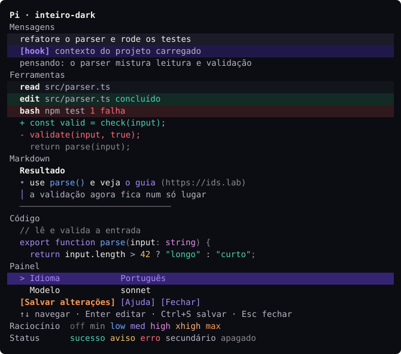
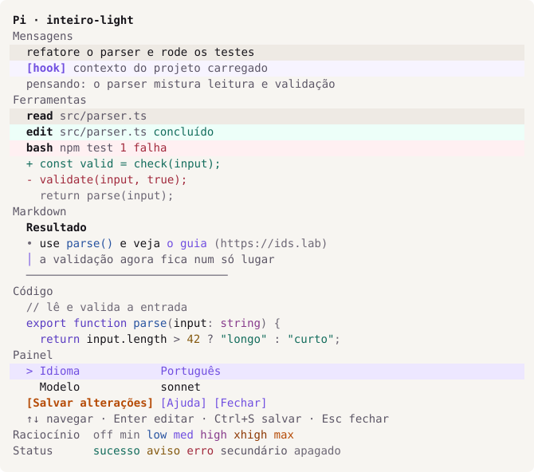

# @inteiro/pi-theme

Temas do INTEIRO para o [Pi Coding Agent](https://github.com/earendil-works/pi): `inteiro-dark`, `inteiro-light`, `inteiro-contrast-dark` e `inteiro-contrast-light`. Os arquivos em `themes/` são gerados dos tokens resolvidos do IDS por `npm run generate:pi-theme`. Não edite à mão.

## Instalar

Não é preciso instalar à parte. As extensões que usam `@inteiro/terminal/pi` chamam `registerInteiroPiThemes(pi)` ao carregar: os temas vão para `<agent-dir>/themes/` e aparecem em `/settings` já na primeira sessão. Um tema que você editou nunca é sobrescrito; `PI_DESIGN_THEMES=off` desliga a instalação.

Sem nenhuma dessas extensões, instale o pacote a partir do checkout do IDS:

~~~sh
pi install ./packages/pi-theme
~~~

Para usar um tema, abra `/settings` e escolha **Theme**, ou grave no `settings.json` do Pi:

~~~json
{ "theme": "inteiro-light/inteiro-dark" }
~~~

O par `claro/escuro` segue a aparência do terminal. Para testar sem mudar a configuração: `pi --use-theme inteiro-dark`.

## Prévia

Gerada com os temas (`preview/`), mostra cada componente do Pi: mensagens, ferramentas, diff, markdown, código, painel, escada de raciocínio e status.

| `inteiro-dark` | `inteiro-light` |
| --- | --- |
|  |  |

Alto contraste: [inteiro-contrast-dark](preview/inteiro-contrast-dark.svg) e [inteiro-contrast-light](preview/inteiro-contrast-light.svg).

## Como os papéis do IDS chegam ao Pi

O schema de tema do Pi é estrito e só aceita os papéis do host. Cada papel recebe o token semântico do IDS que cumpre a mesma função. A tabela completa, com o componente e a regra de cada papel, está em [docs/terminal/pi-theme.md](../../docs/terminal/pi-theme.md).

- **Neutros dominam:** texto, títulos, variáveis, saídas e estrutura.
- **Violeta escolhe:** `accent`, links (como no IDS web), palavras-chave, rótulos de identidade, a Costura (`mdQuoteBorder`) e `selectedBg`.
- **Laranja só para efeito real:** `bashMode` (executar comandos de verdade e, nos painéis, o botão que grava) e o topo da escada de raciocínio.
- **Status mantém o papel:** mint, âmbar e vermelho; caixas de ferramenta na versão sutil.
- **Sintaxe com a paleta categórica, na ordem e sem a 02 (laranja):** palavra-chave 01, função 03, string 04, número 06, tipo 07; o resto neutro.
- **Superfícies se afastam do canvas:** `raised`/`surface` no escuro, `sunken` no claro.

Os painéis feitos com `@inteiro/terminal/pi` usam esses papéis: o item com foco tem `>` e `selectedBg`, a ação que grava usa `bashMode` em negrito, e as outras usam `accent`. Com outro tema do Pi, os painéis continuam corretos, mas nas cores desse tema.

## Contraste

`tests/terminal/pi-theme.test.ts` verifica, em cada tema:
- 4,5:1 para todo papel de texto sobre o canvas do IDS e sobre a própria caixa (mensagem, ferramenta, seleção, ocorrência de busca);
- 3:1 para `border`.

## Limite

O Pi não tem papel para o fundo do terminal, então o tema não o define. Para o resultado verificado, use no terminal o fundo `vars.canvas` do tema (`#0c0d12` no escuro, `#f7f5f1` no claro).
